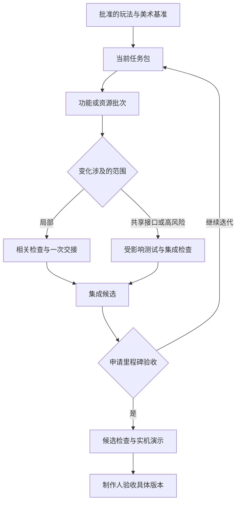

# 工作流规范 v0.8

日期：2026-11-13。状态：待制作人采用的修订稿。用途：Three.js 可玩原型 → 单独规划的 Godot 移植。

本版针对重复读上下文、Agent 往返和打断、过密测试，以及模型/动画质量与完整视频演示，并吸收制作人提供的“七块砖”搭建说明。新增重点是 **M0 就建立 AI 可直接调用的游戏接口**。仓库仍是**规范与模板**，没有游戏运行时、MCP/HTTP 服务、生成服务、gate 脚本或真实演示素材。

## 本版如何工作

1. 一次会话先读简短的 [AGENTS.md](AGENTS.md) 和当前任务；按任务补读必要章节，未变内容沿用。
2. M0 先打通 MCP 或简易 HTTP：AI 能确认实例、读状态、执行动作、观察结果、取得真实截图并关闭游戏。
3. 默认启用 lead 与当前功能负责人。其他角色有独立工作时再启动；tester 按风险与集成批次介入。
4. 一个任务覆盖一个完整功能或资源批次。完成时交接一次，lead 负责提交和补 SHA；执行者不等它回来抄记录。
5. 普通改动做相关检查，功能批次做受影响测试，里程碑最终候选才跑完整 gate。
6. 美术先确定共同基准，再做一个代表性模型与动作。通过视觉验收后扩展资源集合。
7. 完整演示覆盖从开始到结束的路径；只为重要事件标注并生成关键帧，普通操作按区段描述。制作完整参考视频，实现后录制同一路径的完整实机视频并对照。

## 相对 v0.7 的关键变化

| 问题 | v0.8 规则 | 主要位置 |
| --- | --- | --- |
| 多角色重复读长文档 | 短入口、任务相关章节、修订未变则沿用；仅变更/冲突/上下文丢失时恢复 | AGENTS、workflow §3 |
| AI 无法直接观察和操作游戏 | M0 必须提供 MCP 或简易 HTTP；同一运行实例的状态、动作、真实画面贯通 | agent_interface、连接记录模板 |
| 常驻角色和往返过多 | 按需启动；deps 可选；一次完整交接；lead 后填提交信息 | CLAUDE、workflow §1–4 |
| 频繁打断 | 仅取消、会造成明显浪费的失效依赖、破坏/冲突风险才中断；普通建议等任务边界 | AGENTS、workflow §3 |
| 每任务/每提交跑 gate | docs / local / integration / milestone 四档；hook 只检查记录 | validation §2–3 |
| 防御与测试膨胀 | 保护真实输入边界与已知风险，复用已有测试；保持保存冲突、数据合法性等必要约束 | contracts 开头、validation §1 |
| 建模/动画效果一般 | 按资产需求选路线；先证明一个角色的造型、蒙皮、动作接触与衔接；M2 起验收代表性视觉质量 | assets_and_targets §1–4、§6 |
| 生图/生视频要求松散 | 共同美术基准 + 资源/动作规格 + 镜头差异；归档实际发送的完整提示词 | art_prompt、traceability §4 |
| 视频不完整、关键帧数量膨胀 | 只为重要事件生成关键帧；参考与实机分别覆盖开始到结束，普通操作可合并为区段 | demo_storyboard、assets_and_targets §6 |

保留现有角色的源码所有权、lead 提交、独立 tester、制作人批准设计/里程碑、模拟与表现分离、受保护调参，以及 Godot 中文注释与图文说明。请求的模型标签保留在 workflow 的一张表里，是否实际可用在启动时核实。

## 按任务找文件

| 你要做什么 | 入口 |
| --- | --- |
| 配置 Agent 的常驻规则 | [AGENTS.md](AGENTS.md)、[CLAUDE.md](CLAUDE.md) |
| Claude Code 原生任务与 hook 细节 | [Claude 适配说明](docs/claude_adapter.md) |
| 建立 AI 直接访问游戏的 MCP/HTTP 接口 | [游戏接口契约](docs/agent_interface.md) |
| 记录启动命令、地址、实例和实际连接证据 | [游戏连接模板](docs/templates/agent_connection.md) |
| 分工、集成、里程碑与消息规则 | [workflow](docs/workflow.md) |
| 确认架构、数据和编辑器约束 | [contracts](docs/contracts.md) |
| 选择本轮需要的验证 | [validation](docs/validation.md) |
| 资产、动画、重要事件关键帧和完整视频 | [assets_and_targets](docs/assets_and_targets.md) |
| 设计影响分析、生成记录 | [traceability](docs/traceability.md) |
| 给 Agent 发一个精简任务 | [任务包](docs/templates/task_packet.md) |
| 中断后恢复，不重读整个项目 | [恢复记录](docs/templates/checkpoint.md) |
| 写结构化美术提示词 | [提示词模板](docs/templates/art_prompt.md) |
| 写完整演示、重要事件与操作区段 | [分镜模板](docs/templates/demo_storyboard.md) |
| 看已填的分镜/提示词示例 | [守灯人演示示例](docs/examples/demo_workflow_example.md) |
| 写一页策划和必要细则 | [一页策划](docs/gdd/one_page.md)、[GDD 写法](docs/templates/gdd_guide.md)、[美术与音频模板](docs/templates/gdd_art_audio.md) |

模板里的文件名、图片、视频、时间码和状态都需要填实际值；文件移动后调整相对链接。示例仅说明格式，不能当作本项目已批准设计、已有素材或已通过验证。

## AI 如何直接访问游戏

项目必须提供一条从实际 Agent 客户端到运行中游戏的可用通道。先选择 **MCP 或简易本地 HTTP 的一种**，用同一套游戏命令、状态查询和渲染实现；以后需要第二种接入方式时再加薄适配层。普通 HTTP JSON 地址本身不等于 MCP 服务。

| 能力 | 本项目约定的操作名 | AI 可以得到什么 |
| --- | --- | --- |
| 确认连接 | `game_status` | 游戏是否真正就绪、实例 ID、构建/数据版本、能力及限制 |
| 读取状态 | `game_state` | 指定字段的状态快照，不默认返回整个世界或场景树 |
| 执行动作 | `game_act` | 单个动作或有限操作序列，以及实际执行后的观察结果 |
| 查询动作结果 | `game_result` | 原命令是否执行、结果如何；超时后避免盲目重复操作 |
| 取得画面 | `game_capture` | 当前游戏真实渲染的图像及可访问的文件/资源引用 |
| 关闭实例 | `game_shutdown` | 只关闭本次测试实例，并由启动器确认退出 |

这些名称是本项目的接口设计，不是 MCP 自带的游戏工具。详细输入、输出、生命周期、HTTP 路由和职责见 [agent_interface](docs/agent_interface.md)。

M0 的完成证据必须来自实际 Agent：**连接 → 读状态 → 执行一个可观察动作 → 确认响应 → 取得并查看截图 → 关闭**，再重启一次确认新实例和旧请求隔离。只装了 MCP、端口能访问、返回一个 AI 无法读取的图片路径，都不算打通。

日常通过接口操作，不反复抢占桌面窗口。测试启动默认静音、无抢焦点窗口、隔离存档和浏览器存储；需要验证真实按钮/输入时，由 harness 走实际输入链路并检查响应。语义命令成功不能自动证明鼠标能点到按钮。接口、调试面板和相关控制代码在发行构建中剔除。

连接信息与能力表按实例/版本复用，状态按字段读取，动作可以有边界地批量提交。原始日志保留为文件，任务只引用一次。**接口支持随时截图，不代表每次操作都要截图，也不改变重要事件关键帧规则。**

Three.js 阶段规划统一入口 `npm run run-game -- ...`：M0 提供 `--serve`、针对现有内容的 `--check` 和一个真实 `--shot` 场景；M1 核心逻辑建立后再提供 `--simulate`。这是待实现的命令契约，当前模板没有可运行的服务。若 Agent 与游戏不在同一机器，必须配置实际可达的适配/连接方式，不能把云端自己的 localhost 当成游戏机器。

## “七块砖”的吸收方式

| 原说明主题 | 本仓库采用方式 |
| --- | --- |
| 说明书 | AGENTS 保持短入口；CLAUDE 仅 `@AGENTS.md`，客户端细节按需读；设计沿用 `docs/gdd/`，决策分已确认/建议/待决定并保留作废记录 |
| 自己的引擎层 | 按当前切片需要建设模块与平台接口；有明确复用价值时再抽取共享库，已有依赖固定版本 |
| 逻辑和画面分家 | 强化纯逻辑可命令行运行；游戏接口复用真实命令/查询边界；调试代码不进入发行构建 |
| 内容全是数据 | 沿用现有 data/ 与资产清单，新增 UI 中英文键表；可调数值数据化，数学常量不强行搬入 JSON；源素材按实际能力脚本导入 |
| 游戏自检入口 | 统一 runner；检查调用真实实现；新建或修改关键校验器时证明失败/成功路径，平时沿用四档验证 |
| 接口代替桌面操作 | 作为 M0 必交：MCP/HTTP 直连游戏，实例确认、真实状态/动作/画面、测试隔离及发行剔除 |
| 骨架与经验传承 | 重复流程脚本化，Demo 裁剪仅操作发布副本；具体教训放对应文档，跨任务硬规则才进入 AGENTS；按功能批次提交 |

## 四档验证

| 档位 | 典型改动 | 完成时检查 |
| --- | --- | --- |
| docs | 规则、文档、提示词规格 | 相关一致性、引用与 diff |
| local | 局部逻辑、静态美术、普通调参 | 本次相关的编译、数据或视觉检查 |
| integration | 接口变化、时序规则、功能合并 | 受影响测试 + 一次 smoke |
| milestone | 最终候选、对外提交版本 | 完整 gate + 完整实机演示 + 按风险审查 |

检查按实际影响升级：例如时序数据变化虽然只改 JSON，也可能需要 integration。复用旧结果必须证明相关输入和环境未变；旧 SHA 的完整 gate 不能算作新 SHA 通过。未运行就标 `UNVERIFIED`。

M0 是完整 gate 的明确例外：按事先列出的基础检查验收，其中直接游戏接口、隔离默认值、发行剔除和真实截图是必需项；未来阶段标清，不能称为完整 gate 通过。M1 起要求完整候选检查；M2 起要求同一条完整路径的参考视频和实机视频。GDD 一致性在暂未实现自动工具时可用有记录的人工检查，不伪造命令结果。

## 美术与完整视频的最小交付

共同美术基准写镜头、尺度、轮廓、配色、材质、光照和身份一致性。动作规格写关键姿势、阶段、脚/手/道具接触、位移与衔接。在游戏镜头下检查一个实际角色与一套动作后，再批量制作。

关键帧按重要事件触发：首次代表性展示核心机制、明显不同的交互结果、重大阶段/形态/场景变化、胜负反馈，以及需要明确目标的复杂姿势或接触。每个选中事件写一句重要原因并至少引用一张实际图片；准备/接触/结束多帧只在确有需要时增加。普通移动、反馈相同的重复动作、常规菜单操作不需要单独关键帧。

`event_id` 标识一个重要事件或操作区段，`interaction_id` 在适用时标识动作类型。重要事件用 `keyframe_required: true`；普通区段用 `false` 和 `keyframes: []`，不必逐按键建行。视频仍覆盖整条路径，并保留事件/区段到参考与实机时间码、预期与观察结果的映射。**完整路径覆盖与重要事件图片覆盖分别检查**，图片分母只包含选中的重要事件。

参考视频表达目标，实机录屏证明当前构建的行为。视频工具只支持首尾帧时，仅在保留重要姿势确有需要时拆短片；工具要求的镜头边界图属于连续性输入，可复用合适的已有图，不因此给每次普通操作新增关键帧要求。不得假设工具支持任意数量参考帧。

M1 可以用占位画面验证机制；M2 的代表性切片开始验收明确的美术目标和完整演示，后续按内容变化更新。纯像素级相似不是默认要求，但轮廓、身份、动作接触和可读性不能因“只是 Web 原型”而全部免验。

## 如何判断是否真的省 Token

本版改变触发频率与信息流，没有运行真实开发任务的计费对照。对同类功能批次记录一次模型、未缓存/缓存输入、输出、工具调用、Agent 消息、上下文重读、验证次数、耗时与返工；缺失指标写 unknown。按同等完成质量比较，包含失败重试，不把文件字数下降直接宣称为费用下降。

## 改动依据

本版主要是针对 v0.7 仓库规则和制作人反馈的工程调整。四档验证、一次交接、减少状态往返和批次化任务是本项目的设计提案；重要事件关键帧，以及优先建立游戏 MCP/HTTP 接口，来自制作人的明确要求。后续吸收了制作人提供的《给AI的搭建说明》；接口操作名、实例/命令语义和阶段划分仍是本项目的工程设计。没有照搬完整外部 workflow，也没有用实际项目对照证明 Token、速度、返工率或美术效果改善。

公开参考提供了部分可借鉴的模式，引用固定版本便于核对：

| 参考 | 本版借鉴的模式 | 适用边界 |
| --- | --- | --- |
| [gamedev-skills router](https://github.com/gamedev-skills/awesome-gamedev-agent-skills/blob/c6ca6c41c839b68319ffc08430b99ab768debc32/router/SKILL.md) | 选择最小相关技能集，按需读参考，不每轮重新路由 | 支持按需加载方向；没有提供本项目的计费对照 |
| [归藏 game skill](https://github.com/op7418/guizang-game-skill/blob/6001e56e1eaa60be49e5aa4ef81d08b746a1b4e2/SKILL.md) | 分阶段交付、游戏画面与操作验证、区分已验证和仅不报错 | 原文要求代码修改后实际载入并检查控制台；不能据此声称减少验证频率已被证明有效 |
| [Godot Game Harness](https://github.com/jonathancaruso/godot-game-harness/blob/8f4fdf4262b6697f6aacf051c0f927744d81e263/HARNESS.md) | 可重复运行的逻辑检查与画面观察循环 | 原文包含改动后重复 test/shot；本版四档频率和重要事件选帧不是它的结论 |

结构化美术规格用于减少方向和交付要求的歧义，实际建模、动画和生成效果仍需用代表性资产与完整演示验证。

## 实施边界

### 从 v0.7 迁移

- 采用新版入口与当前任务包；进行中的任务保留 ID、GDD 引用与实际进展，补上合适的验证档位。
- 如果实际项目已实现旧 TaskCompleted hook，需要同步改为只读验证记录；仅替换 Markdown 不会让旧 hook 自动停止跑测试。
- 在实际游戏中实现并验证一种直接连接方式；已有接口可复用，通过最小实例/动作/状态/截图闭环后记录实际命令与客户端配置。现有游戏缺少接口时应优先补齐，不能仅靠这份文档声称具备能力。
- 已有配对测试可合并为功能批次，但覆盖责任不能丢失；旧 `done` 没有对应证据时不能自动变成 `verified`。
- 角色收到新版规则后完成当前一致步骤，再在边界交接；不为迁移反复打断或重启所有 Agent。
- 从下一项小功能记录使用量，比较同等交付质量的批次。已有游戏项目的脚本修改属于后续实际接入工作。

### 当前尚未实现

- 这些文档没有实现游戏 MCP/HTTP 服务、任务调度、提交助手、gate、hook、资产校验、GDD 工具或视频生成。先搭最小可玩、直接接口与检查入口，再按需要实现工具。
- M0 不再要求先造齐全部管理设施；缺少助手时可以进行授权范围内的人工提交和检查，不能伪造工具通过记录。
- 合并模板或复制文件不会自动改变现有 Agent 的行为；需要采用新版入口、任务粒度与检查触发规则。
- 外部生成能力、模型可用性、预算和真实视觉效果仍需在具体项目中验证。
