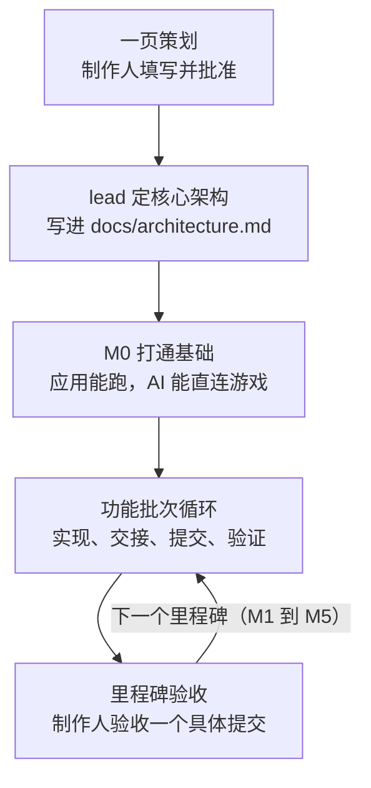
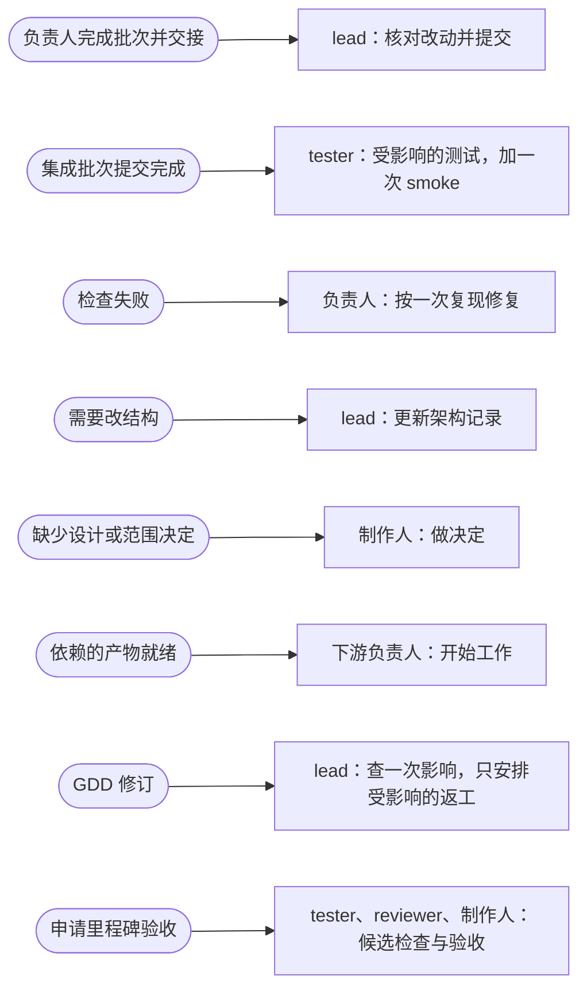
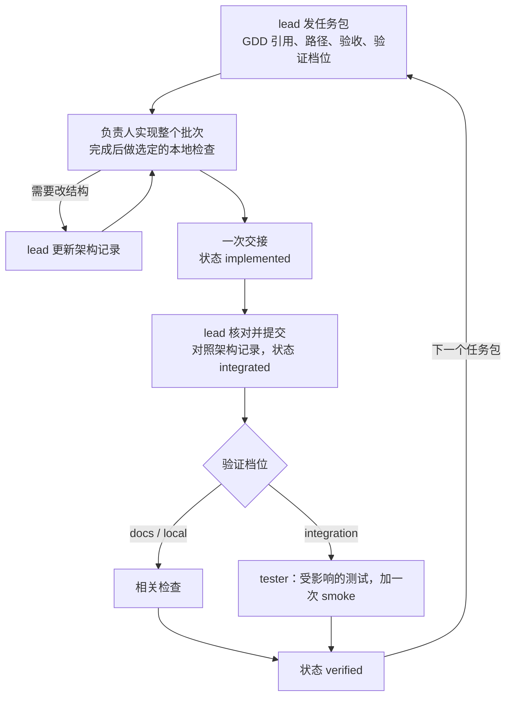
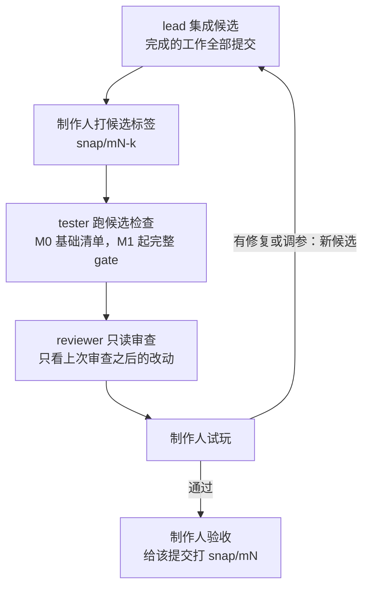
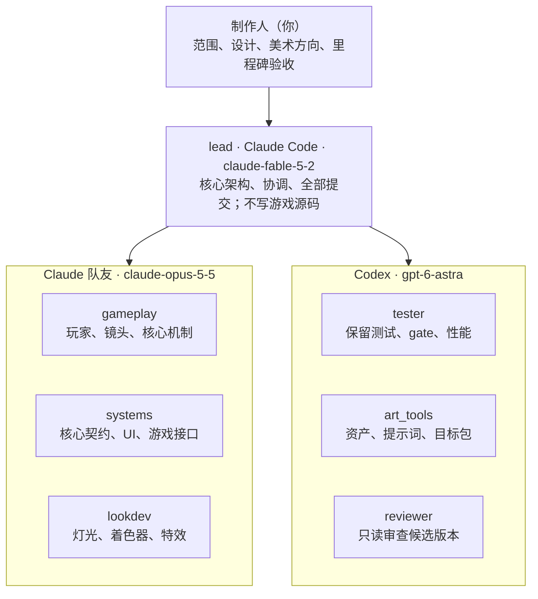
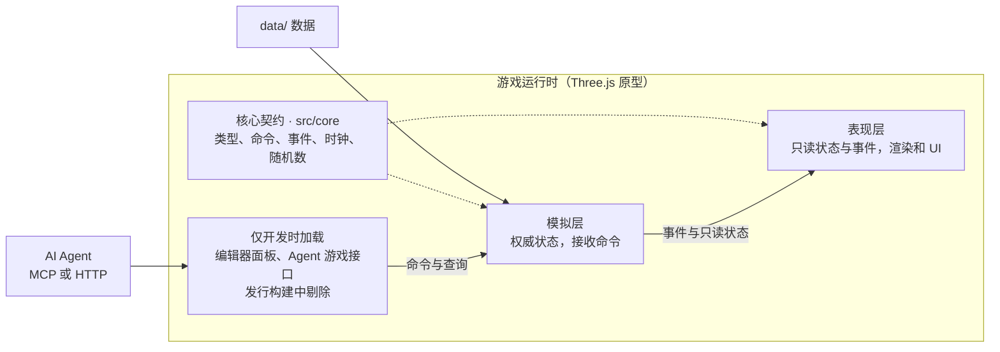

# 游戏工作流模板 v0.9

2026-11-13 由制作人采用。用途：多个 AI Agent 协作做轻量游戏，先做 Three.js 可玩原型，再做单独规划的 Godot 移植。

这个仓库只有**规范与模板**：规则文档、GDD 模板和示例。它不包含游戏运行时、MCP/HTTP 服务、gate 脚本、hook 或任何素材，这些在每个项目的 M0 按需实现。

## 开一个新项目

1. 用模板建仓库并克隆（参数已用 `gh repo create --help` 核对，这条命令本身没有在本仓库执行过）：

   ```bash
   gh repo create <项目名> --private --template ItsYUGAMES/game-workflow-template --clone
   ```

2. 填写 [一页策划](docs/gdd/one_page.md)，把整个游戏写在一页里，然后把它的 `status` 改成 `approved`。写法见 [GDD 写法说明](docs/templates/gdd_guide.md)，填好的例子见 [《守灯人》](docs/examples/gdd_example/one_page.md)。
3. 核心机制在一页里写不清的规则，用 [玩法系统模板](docs/templates/gdd_system.md) 补一篇细则。
4. 在 [AGENTS.md](AGENTS.md) 开头补三样：批准的一句话概念、实际的目录结构、验证过的运行命令和连接方式。
5. 开 Agent 会话时说明它的角色，例如“你是 lead”。没有分到角色的会话会先问，不会自己动手。
6. 让 lead 先写架构记录 `docs/architecture.md`，再推进 M0：应用能跑，并且 AI 能直接连接游戏（见下面“AI 如何直接访问游戏”）。

## 它怎样工作

1. 每个会话先读简短的 AGENTS.md 和当前任务，再按任务补读相关章节；没变的内容不重读。
2. lead 在实现开始前定下核心架构，写进 `docs/architecture.md`；其他 Agent 只在这个架构里实现和测试，要改架构先找 lead。
3. M0 先打通 MCP 或简易 HTTP 接口，让 AI 能确认实例、读状态、执行动作、取得真实截图并关闭游戏。
4. 默认只启用 lead 和当前功能的负责人。其他角色有独立工作时再启动，tester 按风险和集成批次介入。
5. 一个任务覆盖一个完整的功能或资源批次，完成时交接一次。lead 负责提交和补 SHA。
6. 普通改动做相关检查，功能批次跑受影响的测试，只有里程碑候选才跑完整 gate。
7. 美术先定共同基准，再做一个代表性模型和动作，通过视觉验收后才扩展整套资源。
8. 完整演示覆盖从开始到结束的路径；只给重要事件做关键帧，普通操作按区段描述。



## 流程图与架构图

上面的图是总流程。下面五张图依次是：什么事件触发谁、总流程里两步的展开、角色结构和代码结构。规则以各文档为准，图只是摘要。

### 事件驱动：什么事件触发谁

里程碑之间按顺序推进；里程碑之内，每个 Agent 只在下面这些事件发生时行动。没有事件就不发消息、不轮询状态、不跑检查。能打断正在工作的 Agent 的只有三种事件：任务被取消、依赖失效会造成明显浪费、出现破坏性或冲突的操作。规则见 [workflow](docs/workflow.md) §3–4 和 [validation](docs/validation.md) §2。



这是靠规则约定的事件驱动：模板里没有事件总线或调度器，是各 Agent 按规则只在这些时刻行动。计划中唯一的自动触发点是任务完成时的 hook，它只读取记录。

### 一个功能批次

总流程里“功能批次循环”的展开。任务状态依次是 `implemented`、`integrated`、`verified`。规则见 [workflow](docs/workflow.md) §3–4。



### 里程碑验收

总流程里“里程碑验收”的展开。两个标签都由制作人打。规则见 [workflow](docs/workflow.md) §5 和 [validation](docs/validation.md) §3、§5。



### 角色架构

默认只启用 lead 和当前功能的负责人，其他角色按需启动；可选的 deps 子 Agent 没有画出。每个角色拥有的路径见 [workflow](docs/workflow.md) §2。



### 游戏运行时的分层

模板的通用约束，见 [contracts](docs/contracts.md) §1。每个项目的具体模块划分由 lead 写进 `docs/architecture.md`。



## 你在每个里程碑验收什么

以 [workflow](docs/workflow.md) §5 为准，这里只是摘要。

| 里程碑 | 成果 | 开工前要批准的 GDD |
| --- | --- | --- |
| M0 | 应用和最小检查能跑；AI 能连接、读状态、执行动作、取到真实截图、关闭并重连；测试隔离、发行剔除和需要的调参保存已演示 | 一页策划 |
| M1 | 核心动作用占位画面可玩，并通过接口暴露；`--simulate` 场景跑真实的模拟模块；有相关的风险检查 | 一页策划、核心玩法细则 |
| M2 | 完整的开始、游戏、结束切片；代表性的外观与动作目标；重要事件有关键帧；参考视频和实机视频各覆盖整个切片 | 美术与音频、界面、代表性关卡 |
| M3 | 批准的内容全部集成，模型和动画达到代表性质量；新的重要事件补关键帧 | 内容与进度、其余关卡 |
| M4 | 约定的手感和性能标准通过；阻塞缺陷解决；演示路径稳定 | — |
| M5 | 最终候选、完整实机视频、参考视频包、报告、来源记录、可移植导出 | — |

M0 按事先列好的基础检查验收，不算完整 gate 通过；完整 gate 从 M1 起要求。你验收的是一个具体的提交，候选打 `snap/mN-k` 标签，验收后打 `snap/mN`，标签由你来打。

## AI 如何直接访问游戏

项目必须提供一条从实际 Agent 客户端到运行中游戏的通道。先在 **MCP 和简易本地 HTTP 里选一种**，以后需要第二种时再加一层薄适配。普通的 HTTP JSON 地址不等于 MCP 服务。

| 能力 | 操作名 | AI 得到什么 |
| --- | --- | --- |
| 确认连接 | `game_status` | 游戏是否就绪、实例 ID、构建和数据版本、能力及限制 |
| 读取状态 | `game_state` | 指定字段的状态快照 |
| 执行动作 | `game_act` | 单个动作或有限的操作序列，以及执行后的观察结果 |
| 查询动作结果 | `game_result` | 原命令是否执行、结果如何；超时后先查，不盲目重发 |
| 取得画面 | `game_capture` | 游戏真实渲染的图像，以及 AI 能读取的文件或资源引用 |
| 关闭实例 | `game_shutdown` | 只关闭本次测试实例，由启动器确认退出 |

这些操作名是本项目的接口设计，不是 MCP 自带的工具。输入输出、生命周期、HTTP 路由和职责见 [游戏接口契约](docs/agent_interface.md)。

M0 的证据必须来自实际的 Agent：连接 → 读状态 → 执行一个可观察的动作 → 确认响应 → 取得并查看截图 → 关闭，然后重启一次，确认是新实例、旧请求被拒绝。只装了 MCP、端口能访问、或返回一个 AI 读不到的图片路径，都不算打通。

测试启动默认静音、不抢焦点、隔离存档和浏览器存储。语义命令成功不能证明鼠标点得到按钮，需要时由 harness 走真实输入链路。接口和调试代码在发行构建里剔除。接口能随时截图，不代表每次操作都要截图。

## 四档验证

| 档位 | 典型改动 | 完成时检查 |
| --- | --- | --- |
| docs | 规则、文档、提示词规格 | 相关一致性、引用与 diff |
| local | 局部逻辑、静态美术、普通调参 | 本次相关的编译、数据或视觉检查 |
| integration | 接口变化、时序规则、功能合并 | 受影响的测试，加一次 smoke |
| milestone | 最终候选、对外提交的版本 | 完整 gate、完整实机演示、按风险审查 |

档位按实际影响选：只改 JSON 的时序数据也可能需要 integration。复用旧结果要证明相关输入和环境没变；旧提交的完整 gate 不能算作新提交通过；没运行的检查标 `UNVERIFIED`。细则见 [validation](docs/validation.md)。

## 美术与完整视频

- **共同美术基准**写镜头、尺度、轮廓、配色、材质、光照和身份一致性，放在美术与音频策划案里，任务只引用它的版本。
- **动作规格**写关键姿势、阶段、脚和手及道具的接触、位移与衔接，在游戏镜头下检查实际模型。
- **关键帧只给重要事件**：核心机制的首次展示、明显不同的交互结果、重大的阶段或场景变化、胜负反馈、需要明确目标的复杂姿势。每个选中的事件写一句原因，至少配一张实际图片。
- **两份视频覆盖同一条路径**：参考视频表达目标，实机录屏证明当前构建做到了什么，两者分别交付。
- **两项覆盖分开检查**：完整路径是否走完，以及选中的重要事件是否都有图片；图片的分母只算选中的事件。

M1 可以用占位画面，M2 的代表性切片开始验收美术目标。细则见 [assets_and_targets](docs/assets_and_targets.md) §6，填好的例子见 [守灯人演示示例](docs/examples/demo_workflow_example.md)。

## 按任务找文件

| 你要做什么 | 入口 |
| --- | --- |
| 配置 Agent 的常驻规则 | [AGENTS.md](AGENTS.md)（[CLAUDE.md](CLAUDE.md) 只引用它） |
| Claude Code 原生任务与 hook | [Claude 适配说明](docs/claude_adapter.md) |
| 建立 AI 直接访问游戏的接口 | [游戏接口契约](docs/agent_interface.md)、[连接记录模板](docs/templates/agent_connection.md) |
| 分工、集成、里程碑与消息规则 | [workflow](docs/workflow.md) |
| 架构、数据和编辑器约束，代码约定 | [contracts](docs/contracts.md) |
| 选择本轮需要的验证 | [validation](docs/validation.md) |
| 资产、动画、关键帧和完整视频 | [assets_and_targets](docs/assets_and_targets.md) |
| 设计改动的影响分析、生成记录 | [traceability](docs/traceability.md) |
| 给 Agent 发一个任务 | [任务包](docs/templates/task_packet.md) |
| 中断后恢复 | [恢复记录](docs/templates/checkpoint.md) |
| 写一页策划 | [一页策划](docs/gdd/one_page.md)、[GDD 写法说明](docs/templates/gdd_guide.md) |
| 写细则文档 | [玩法系统](docs/templates/gdd_system.md)、[界面与流程](docs/templates/gdd_ui.md)、[关卡](docs/templates/gdd_level.md)、[内容与进度](docs/templates/gdd_content.md)、[美术与音频](docs/templates/gdd_art_audio.md) |
| 写美术提示词和演示分镜 | [提示词模板](docs/templates/art_prompt.md)、[分镜模板](docs/templates/demo_storyboard.md) |
| 看填好的例子 | [《守灯人》GDD](docs/examples/gdd_example/README.md)、[演示示例](docs/examples/demo_workflow_example.md) |

模板里的文件名、图片、视频、时间码和状态都要填实际值。示例只说明格式，不是已批准的设计或已通过的验证。

## 相对 v0.8 的变化（v0.9）

核心架构由 lead 在实现开始前定下，写进项目的 `docs/architecture.md`：技术栈与目录、模块边界、当前里程碑需要的核心契约、接口走 MCP 还是 HTTP、哪些先不做。

- gameplay、systems、lookdev、art_tools 只在这个架构里实现，tester 只测试。
- 需要改架构时向 lead 提出，lead 更新记录后再继续。lead 提交前按记录核对每个任务的改动。
- lead 只写架构记录，不写游戏源码；核心契约由 systems 实现。
- 破坏性的架构变更由 lead 决定。只有会改变已批准的玩法含义、受保护的调参或存档、或项目范围时，才需要你批准。

这一版还取消了普通资产和任务对文件哈希的要求，见下面“轻量化版本与 Hash 追踪”。

架构规则在 workflow §1 和 contracts §2。模板仓库里没有 `docs/architecture.md`，它由每个项目的 lead 在 M0 派任务前写。

## 相对 v0.7 的变化（v0.8）

| 问题 | v0.8 的规则 | 主要位置 |
| --- | --- | --- |
| 多个角色重复读长文档 | 短入口，按任务读相关章节，修订没变就沿用 | AGENTS、workflow §3 |
| AI 没法直接观察和操作游戏 | M0 必须提供 MCP 或简易 HTTP 接口 | agent_interface |
| 常驻角色和往返过多 | 按需启动；deps 可选；一次交接；lead 补提交信息 | claude_adapter、workflow §1–4 |
| 频繁打断 | 只有取消、会造成明显浪费的失效依赖、破坏或冲突风险才中断 | AGENTS、workflow §3 |
| 每个任务、每次提交都跑 gate | 四档验证；hook 只检查记录 | validation §2–3 |
| 每块内容都要先写细则 | 已有批准文档说不清的新功能才补细则 | workflow §5、gdd_guide |
| 建模和动画效果一般 | 按需求选制作路线；先证明一个角色的造型、蒙皮和动作 | assets_and_targets §1–4 |
| 生图、生视频的要求松散 | 共同基准 + 资源或动作规格 + 镜头差异；归档实际发送的完整提示词 | art_prompt、traceability §4 |
| 视频不完整、关键帧过多 | 只给重要事件做关键帧；参考与实机各覆盖整条路径 | demo_storyboard、assets_and_targets §6 |

没有变的：各角色的源码所有权、lead 提交、独立的 tester、制作人批准设计和里程碑、模拟与表现分离、受保护的调参，以及 Godot 阶段的中文注释和图文说明。

这一版还改变了三项此前的做法：deps 子 Agent 从必用变为可选，不再给每张实现卡配一张测试卡，Agent 可以应要求直接起草 `docs/` 下的修改（批准仍由制作人做）。

## 依据与证据边界

四档验证、一次交接、批次化任务是针对 v0.7 规则的工程调整；重要事件关键帧和优先建立游戏接口来自制作人的要求，并吸收了制作人提供的《给AI的搭建说明》。**没有用真实项目做过对照**，Token、速度、返工率和美术效果的改善都还没有测量。文件变短不等于费用下降。

要判断是否真的省了：对同类的功能批次各记录一次模型、缓存与未缓存的输入、输出、工具调用、Agent 消息、上下文重读、验证次数、耗时和返工，缺的指标写 `unknown`，在同等完成质量下比较。

公开参考只提供了部分模式，链接固定在具体版本：

| 参考 | 借鉴的模式 | 不能据此得出的结论 |
| --- | --- | --- |
| [gamedev-skills router](https://github.com/gamedev-skills/awesome-gamedev-agent-skills/blob/c6ca6c41c839b68319ffc08430b99ab768debc32/router/SKILL.md) | 选最小的相关技能集，按需读参考 | 本项目的费用会下降 |
| [归藏 game skill](https://github.com/op7418/guizang-game-skill/blob/6001e56e1eaa60be49e5aa4ef81d08b746a1b4e2/SKILL.md) | 分阶段交付，用实际画面和操作验证 | 减少验证频率是有效的（原文要求每次改动后载入检查） |
| [Godot Game Harness](https://github.com/jonathancaruso/godot-game-harness/blob/8f4fdf4262b6697f6aacf051c0f927744d81e263/HARNESS.md) | 可重复的逻辑检查与画面观察循环 | 四档频率和重要事件选帧（原文每次改动后都重复检查） |

## 还没有实现的

- 游戏的 MCP/HTTP 服务、`npm run run-game`、gate、hook 适配器、提交助手、资产校验、`gdd:check` 和 `gdd:impact` 都只是待实现的接口约定。
- 完成钩子在 Claude Code 上的拦截行为（只有退出码 2 拦截等）来自 v0.7 的记录，要在 M0 用实际客户端重新验证。
- 外部生成工具的能力、模型是否可用、预算和实际视觉效果，都要在具体项目里验证。
- 已经在用 v0.7 的项目：旧的 TaskCompleted hook 要改成只读记录；已有的配对测试可以合并到功能批次，但覆盖不能丢。

## 轻量化版本与 Hash 追踪

日常任务、模型、概念图、视频和生成记录默认使用稳定 ID、文件路径与批准版本；修改已批准资产时升级版本或新增版本文件，不静默覆盖。生成记录继续保存实际 Prompt、参数、提供方、参考来源和结果，但不再强制每个输入/输出文件的 SHA-256。

集成时由 lead/Git 检查变更与必要的验证证据，不要求执行者反复传递文件 Hash 或基础提交 SHA。只有冻结关键交付物、精确复现或完整性检查确实要求逐字节一致时，才由工具自动计算内容 Hash。里程碑的 Git SHA、编辑器保存冲突保护、游戏实例/命令身份仍保留。详见 [traceability §0](docs/traceability.md#0-lightweight-identity-policy)。

## 版本记录

| 版本 | 日期 | 内容 |
| --- | --- | --- |
| v0.9 | 2026-11-13 | 核心架构由 lead 先定并记录，其他 Agent 只实现和测试；普通资产和任务不再要求文件哈希 |
| v0.8 | 2026-11-13 | 精简协作流程；M0 必须有 AI 直连游戏的接口；四档验证；重要事件关键帧与两份完整视频 |
| v0.7 | 2026-11-10 | 细则文档分五类，各有模板 |
| v0.6 | 2026-11-10 | GDD 改为“一页策划 + 细则文档”，编号改为每篇文档一个 |
| v0.5 | 2026-11-10 | 规则不再预设游戏类型；`combat` 角色改名为 `gameplay` |
| v0.4 | 2026-11-10 | 初版：角色分工、lead 提交、独立 tester、GDD 追踪、提示词归档 |
