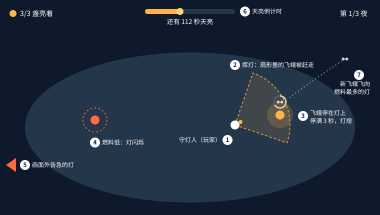

# 守灯人一页策划

**一句话：** 玩家扮演小岛上的守灯人，在几盏油灯之间奔走，给快熄的灯续火、赶走扑灯的飞蛾，撑到天亮；难点在于永远有不止一盏灯在告急。

俯视角动作小品 ｜ 桌面浏览器 ｜ 一局三夜，约 10 分钟 ｜ 给喜欢短局、手忙脚乱型游戏的玩家 ｜ 参考《胡闹厨房》的多线照看

## 玩法

**循环：** 看哪盏灯最急 → 跑过去 → 续火或赶蛾 → 再看。刚续完火的灯燃料最多，也最招飞蛾，“先救哪盏”就从这里来。

| 玩家能做 | 世界会做 |
| --- | --- |
| **走**：满速 4.5 米/秒 | **灯**：燃料 45 秒，亮着就减，烧完熄灭 |
| **续火**：在灯旁按住 0.6 秒，燃料回满 | **飞蛾**：飞向燃料最多的灯，停满 3 秒灯就熄 |
| **挥灯**：向前扇形赶走飞蛾，冷却 1.2 秒 | **夜晚**：越深飞蛾越多，一夜比一夜密 |

**赢：** 撑过 180 秒天亮；三夜都过即通关。\
**输：** 所有灯同时熄灭满 5 秒；从本夜开头重来。

## 体验

1. **判断胜过手速**：难点是先救哪盏，不是操作。两个方案冲突时，选让判断更重要的那个。
2. **一眼读懂**：灯火是画面里唯一的暖色，每盏灯的状态远处就能看清。
3. **短而完整**：一夜 3 分钟，输了马上能重来。

## 设定

- **操作**：WASD 移动，E 续火，J 挥灯，Esc 暂停；支持手柄
- **镜头**：3D 俯视 55°，跟随角色，不能旋转；画面外告急的灯有箭头提示
- **时间**：实时；暂停时一切停止；切到后台自动暂停；没有慢动作
- **画面与声音**：低多边形，深蓝夜色配暖黄灯火；三层循环夜曲

## 范围

- **必须有**：三夜、一座岛、续火、飞蛾、挥灯、键盘和手柄
- **时间够再做**：鼠标点击移动；会躲开挥灯的飞蛾
- **这次不做**：存档、商店升级、剧情、排行榜、触屏、冲刺
- **做完的标准**：三夜都能通关；没玩过的人 1 分钟内看懂；集成显卡笔记本稳定 60 FPS

## 系统与待定

- [续火](systems/relight.md)：gameplay，M1 前，已批准 r2
- [飞蛾与挥灯](systems/moth.md)：gameplay，M1 前，已批准 r1
- 界面与流程：systems，M2 前，待写
- [冲刺](systems/dash.md)：已废弃
- **待定**：要不要支持鼠标点击移动（制作人，M2 前，不阻塞 M1）；音乐自己生成还是用素材包（制作人，M3 前）

---

修改记录 ｜ r2 2026-11-12 制作人：“输”从全灭立即失败改为全灭满 5 秒，原来太苛刻；冲刺移到“这次不做” ｜ r1 2026-11-10 制作人：初稿
