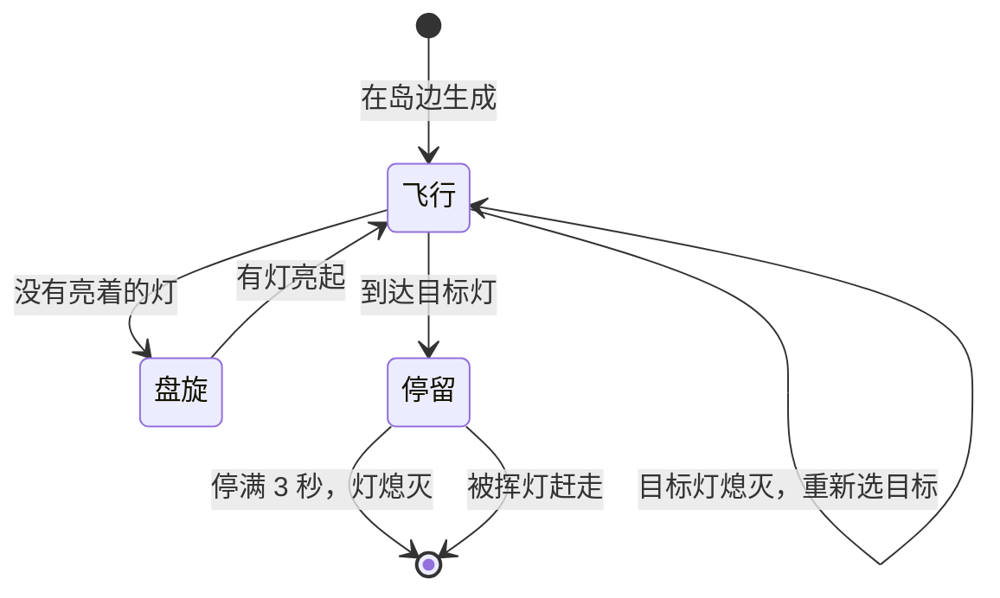

# 守灯人飞蛾与挥灯系统策划案

| 版本 | 日期 | 修改人 | 修改内容 |
| --- | --- | --- | --- |
| r1 | 2026-11-10 | 制作人 | 初稿 |

## 一、概述

### 1.1 设计目的

制造“先救哪盏”的压力。飞蛾偏爱最亮的灯，刚续完火的灯反而最招飞蛾，玩家不能只守着一盏灯续火。

### 1.2 系统概述

飞蛾从岛边飞来，停到燃料最多的亮灯上，停满 3 秒灯就熄灭。玩家向飞蛾挥灯就能把它赶走。夜越深，飞蛾来得越快。

### 1.3 名词解释

| 名词 | 解释 |
| --- | --- |
| 挥灯 | 向面朝方向挥动提灯，赶走扇形范围内的飞蛾 |
| 停留 | 飞蛾停在灯上，开始计时 |

## 二、规则

### 2.1 流程

### 2.2 详细规则

1. 飞蛾从岛边的生成点出现，飞向**燃料最多的亮灯**。
2. 到达后停在灯上。连续停留 **3 秒**，灯熄灭，飞蛾随之消失。
3. 挥灯：向面朝方向挥出一个**半径 2.5 米、角度 90°** 的扇形，冷却 **1.2 秒**。扇形内的飞蛾被赶走，立即消失，停留计时作废。
4. 一盏灯最多停 **2 只**飞蛾。停满后，后来的飞蛾改去燃料第二多的灯。
5. 生成节奏随夜晚变化，见 4.2。

### 2.3 特殊情况与容差

- 两盏灯燃料相同：选编号小的那盏。
- 同一盏灯上停着两只飞蛾：任何一只停满 3 秒，灯就熄灭，另一只一起消失。
- 冷却中按挥灯无效，冷却结束后也不会自动补发。
- 挥灯时角色可以移动。
- 飞蛾中心恰好在扇形边缘（偏离面朝方向 45°）算命中。

## 三、界面与反馈

1. **停留进度**：飞蛾停在灯上时，灯上方显示飞蛾图标，图标外圈的圆环表示停留了多久。
2. **挥灯冷却**：显示在角色脚下的弧线上。
3. **被赶走**：飞蛾播放一小段逃离动画后消失。动画多长都不影响规则，飞蛾在被命中的那一刻就已经不算停留了。

## 四、数值

### 4.1 飞蛾与挥灯

| 字段 | 含义 | 单位 | 暂定值 | 范围 | 生效时机 |
| --- | --- | --- | --- | --- | --- |
| `moth_speed_mps` | 飞行速度 | m/s | 2.0 | 1–3.5 | next_tick |
| `moth_extinguish_s` | 停留多久灯会熄灭 | s | 3 | 1.5–5 | next_action（每只飞蛾停下时取值） |
| `moth_max_per_lamp_count` | 一盏灯最多停几只 | 只 | 2 | 1–3 | next_tick |
| `swing_range_m` | 挥灯半径 | m | 2.5 | 1.5–3.5 | next_tick |
| `swing_angle_deg` | 挥灯扇形的总角度 | ° | 90 | 60–150 | next_tick |
| `swing_cooldown_s` | 挥灯冷却 | s | 1.2 | 0.6–2.0 | next_action |

### 4.2 每夜的生成节奏

写在 `data/levels/night_〈n〉.json` 里，字段为 `moth_spawn_interval_start_s`、`moth_spawn_interval_end_s`、`moth_max_alive_count`，生效时机都是 restart。

| 夜 | 生成间隔（开始 → 结束） | 同时存在的上限 |
| --- | --- | --- |
| `night_1` | 8 秒 → 5 秒 | 3 只 |
| `night_2` | 6 秒 → 4 秒 | 4 只 |
| `night_3` | 5 秒 → 3 秒 | 6 只 |

一夜之内，生成间隔从开始值匀速缩短到结束值。飞蛾数量到上限时暂停生成，有飞蛾消失后再恢复。

## 五、美术与音效需求

| 资源 | 用途 | 数量与规格 | 参考 |
| --- | --- | --- | --- |
| `enm_moth` 飞蛾 | 唯一的敌对对象 | 1 个；`fly`、`perch`、`flee` 三段动画；不超过 1000 个三角面 | 一页策划的关键画面 |
| `fx_swing` 挥灯轨迹 | 挥灯时的扇形光迹 | 1 个；形状和扇形范围一致 | |
| `sfx_swing` | 挥灯 | 1 段 | |
| `sfx_moth_flee` | 飞蛾被赶走 | 1 段 | |

## 六、验收要点

- 飞蛾停了 2.9 秒时被赶走，灯不熄。
- 灯上停满 2 只后，第 3 只飞向燃料第二多的灯。
- 恰好在扇形边缘（45°）的飞蛾被赶走。
- 用同一个随机种子回放两次，飞蛾的生成和选目标完全一样。

## 七、待定问题

| 问题 | 谁来定 | 最晚 | 是否阻塞 |
| --- | --- | --- | --- |
| 第三夜要不要加一种会躲开挥灯的飞蛾 | 制作人 | M3 前 | 阻塞第三夜的内容，不阻塞 M1 |
