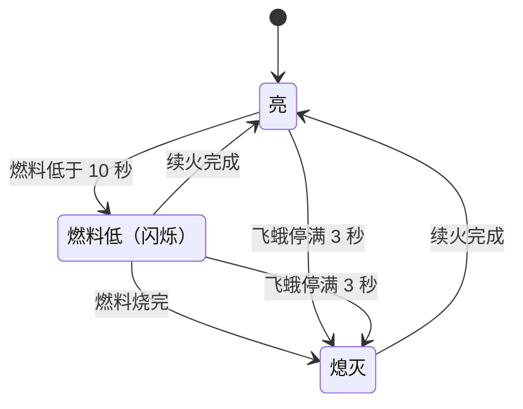
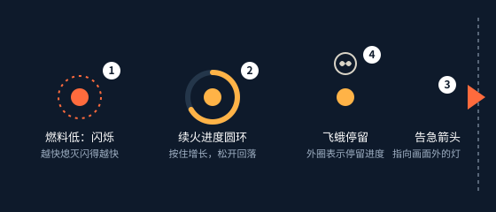

# 守灯人续火系统策划案

| 版本 | 日期 | 修改人 | 修改内容 |
| --- | --- | --- | --- |
| r2 | 2026-11-12 | 制作人 | 2.2 第 4 条：松手后进度不再清零，改为按一半速度回落，原来太容易前功尽弃。四：新增 `relight_decay_ratio` |
| r1 | 2026-11-10 | 制作人 | 初稿 |

## 一、概述

### 1.1 设计目的

让每盏灯都处在倒计时里，逼玩家在几盏灯之间分配注意力。续火要按住一小会儿：停下来续火的那一刻，就是放下别处的代价。

### 1.2 系统概述

每盏灯有燃料，亮着时不断减少，烧完就熄灭。玩家走到灯旁按住续火键，按满 0.6 秒，燃料回满。熄灭的灯也用同样的方法重新点亮。有飞蛾停在灯上时不能续火，要先赶走飞蛾（见[飞蛾系统](moth.md)）。

### 1.3 名词解释

| 名词 | 解释 |
| --- | --- |
| 燃料 | 灯还能亮多久，单位是秒 |
| 续火 | 按住续火键，把燃料加满；熄灭的灯也用它点亮 |
| 告急 | 燃料低于 10 秒，或者有飞蛾停在灯上 |

## 二、规则

### 2.1 流程

### 2.2 详细规则

1. 每盏灯的燃料满值是 **45 秒**。灯亮着时，燃料每秒减 1。
2. 燃料到 0，灯**熄灭**。
3. 角色在灯 **1.2 米**以内按住 `interact` 开始续火，按满 **0.6 秒**，燃料回满，灯变亮。范围内有几盏灯时，选最近的一盏。
4. 续火中松开按键或走出范围，进度**按积累速度的一半回落**，直到 0。回到范围内再按住，从剩下的进度接着算。
5. 续火中挥灯，进度**立即清零**。
6. 续火时角色不能移动，移动输入被忽略；松开后立刻按当前输入移动。
7. 有飞蛾停在灯上时，按住续火**没有进度**，要先赶走飞蛾。

### 2.3 特殊情况与容差

- 续火完成的那一刻燃料恰好到 0：续火优先，灯不熄。
- 两盏灯离角色一样近：选编号小的那盏。
- 续火进度记在灯上。换一盏灯续火，原来那盏的进度按第 4 条回落。
- 续火中暂停：进度保留。继续时还按着就接着计时，否则按第 4 条回落。
- 距离按角色中心到灯中心的水平距离计算，**恰好 1.2 米算在范围内**。
- 续火时间按模拟步长计算，0.6 秒换算成步数时向上取整。
- 在编辑器里调低燃料满值：燃料超过新上限的灯，截到新上限。
- 续火中改了续火时长：这一次续火仍按开始时的数值。

## 三、界面与反馈

1. **燃料低于 10 秒时灯闪烁**，越接近熄灭闪得越快，周期从 0.8 秒缩短到 0.15 秒。
2. **续火进度**：灯周围的圆环，按住时增长，松开时回落。
3. **告急箭头**：告急的灯在画面外时，屏幕边缘显示指向它的箭头，灯回到画面内后消失。
4. **飞蛾停留**：灯上方显示飞蛾图标，见飞蛾系统 三、第 1 条。

这些反馈只读取游戏状态。关掉所有特效，胜负结果不变。

## 四、数值

| 字段 | 含义 | 单位 | 暂定值 | 范围 | 生效时机 |
| --- | --- | --- | --- | --- | --- |
| `lamp_fuel_max_s` | 燃料满值 | s | 45 | 30–60 | next_tick |
| `lamp_low_fuel_s` | 低于这个值开始闪烁 | s | 10 | 5–15 | next_tick |
| `interact_radius_m` | 续火范围 | m | 1.2 | 0.8–2.0 | next_tick |
| `relight_hold_s` | 续火要按住多久 | s | 0.6 | 0.3–1.0 | next_action |
| `relight_decay_ratio` | 松手后的回落速度，是积累速度的几倍 | 倍 | 0.5 | 0–2 | next_tick |
| `flicker_period_max_s` | 刚开始闪烁时的周期 | s | 0.8 | 0.4–1.2 | next_tick |
| `flicker_period_min_s` | 快熄灭时的周期 | s | 0.15 | 0.1–0.4 | next_tick |

## 五、美术与音效需求

| 资源 | 用途 | 数量与规格 | 参考 |
| --- | --- | --- | --- |
| `prp_lamp` 油灯 | 续火的对象 | 1 个；亮、闪烁、熄灭三种表现；不超过 1000 个三角面 | 一页策划的关键画面 |
| `fx_lamp_fire` 灯火 | 灯亮时的火光 | 1 个；亮度随燃料变化 | |
| `sfx_relight_loop` | 续火过程中循环播放 | 1 段，能无缝循环 | |
| `sfx_lamp_relit` | 续火完成 | 1 段 | |
| `sfx_lamp_out` | 灯熄灭 | 1 段 | |

## 六、验收要点

- 满燃料的灯 **45 秒**后熄灭，误差不超过一个模拟步长。
- 按住 0.6 秒，燃料回满；按 0.3 秒就松开，进度在 0.6 秒内回落到 0。
- 续火到 0.4 秒时挥灯，进度立即回到 0。
- 距离恰好 1.2 米能续火，1.21 米不能。
- 有飞蛾停在灯上时按住续火，进度不增加。
- 暂停 10 秒后继续，每盏灯的燃料和暂停前一样。

## 七、待定问题

无。
