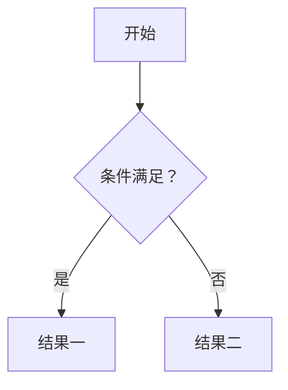

# 〈项目名〉〈系统名〉策划案

| 版本 | 日期 | 修改人 | 修改内容 |
| --- | --- | --- | --- |
| r1 | 〈日期〉 | 〈名字〉 | 初稿 |

> 使用方法：已有批准文档无法清楚说明这块规则时，才新增本细则；多个相关任务可共用它，普通调参和局部修复无需另写策划或重新批准未变的规则。复制到 `docs/gdd/systems/〈name〉.md`，把 `id` 改成 `GDD-` 加大写文件名，在一页策划的“细则与待定”里加一行。写法见 [GDD 写法说明](gdd_guide.md)，例子见 [《守灯人》续火系统](../examples/gdd_example/systems/relight.md)。
>
> 全文控制在两三页，太长就拆成两个系统。一页策划里已经写过的不要重复，放链接。用不上的章节整章删掉；写完删掉这段使用方法和所有「提示」。

## 一、概述

### 1.1 设计目的

> 提示：这个系统为什么存在，让玩家体验到什么。一两句话，不要用游戏里的专有名词。

### 1.2 系统概述

> 提示：一段话说清核心规则和玩家的体验过程：从哪里开始，做什么，得到什么。

### 1.3 名词解释

> 提示：只解释本文新出现、别人可能看不懂的词，控制在几个以内。

| 名词 | 解释 |
| --- | --- |
|  |  |

## 二、规则

### 2.1 流程

> 提示：有分支或有状态切换，就画图。

### 2.2 详细规则

> 提示：一条规则一句话，写成“在什么情况下，发生什么”，关键数字和结果加粗。引用时写作“§2.2 第 3 条”。

1.
2.

### 2.3 特殊情况与容差

> 提示：两件事同时发生、动作被打断、数值到上下限、暂停中、误操作，各自怎么处理。判定的容差也写在这里，比如“距离恰好等于范围时算在范围内”。

-

## 三、界面与反馈

> 提示：放原型图或示意图（存到 `docs/gdd/images/〈name〉/`），在图上标数字，下面按数字逐条说明。这里只写玩家必须看到或听到才能正确操作的反馈，纯装饰的效果写到第五章。

1.

## 四、数值

> 提示：字段名就是 `data/` 里的字段名，带单位后缀。暂定值只是起点，之后以编辑器里调好的值为准，不用回来改这张表。“生效时机”填 `next_tick`（下一帧）、`next_action`（下一次动作）、`rebuild`（重建）或 `restart`（重开本局）。

| 字段 | 含义 | 单位 | 暂定值 | 范围 | 生效时机 |
| --- | --- | --- | --- | --- | --- |
|  |  |  |  |  |  |

## 五、美术与音效需求

| 资源 | 用途 | 数量与规格 | 参考 |
| --- | --- | --- | --- |
|  |  |  |  |

## 六、验收要点

> 提示：写能看到或能测量的结果，包括恰好在边界上的情况。tester 按这一章写测试。

-

## 七、待定问题

| 问题 | 谁来定 | 最晚 | 是否阻塞 |
| --- | --- | --- | --- |
|  |  |  |  |
